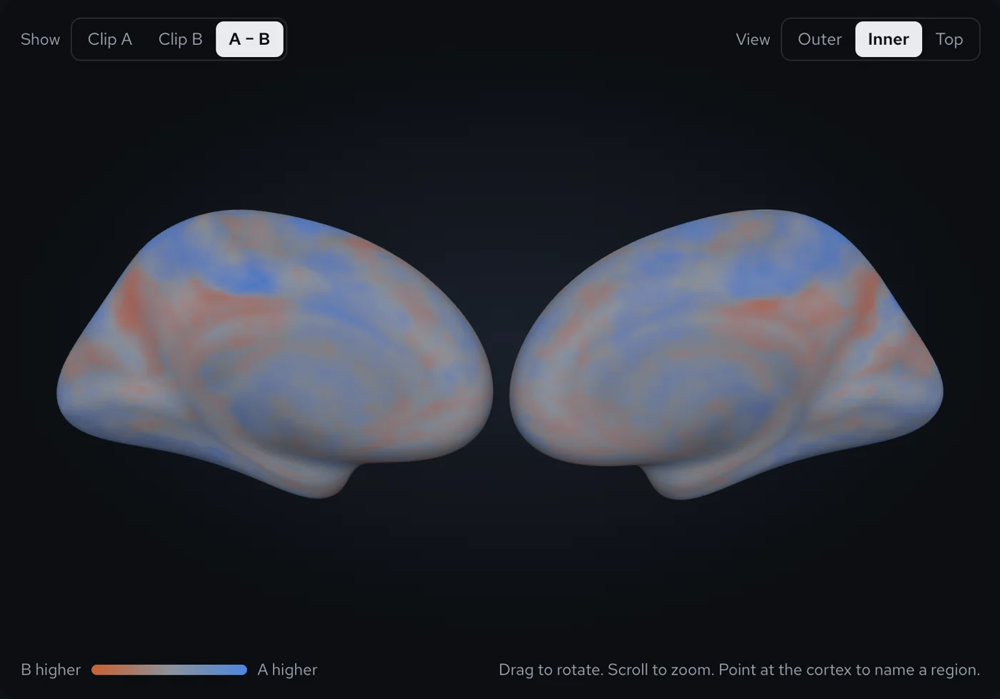
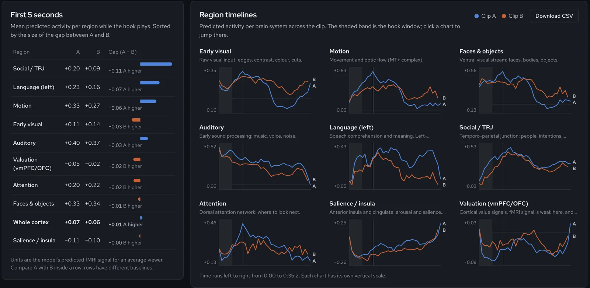

# Cortex A/B

Compare two versions of a video clip by the brain response Meta's
[TRIBE v2](https://github.com/facebookresearch/tribev2) predicts for each.

Upload clip A and clip B. For every second of each clip, TRIBE v2 predicts
fMRI activity at ~20,000 points on the cortex of an average viewer. Cortex A/B
shows where the two versions differ:

- **3D cortex**, synced to the videos, coloured by clip A, clip B, or the A − B difference
- **Hook table**: mean activity per brain system in the first 3, 5 or 8 seconds, sorted by the gap between A and B
- **Region timelines** for nine brain systems, with CSV export





> **This is not a virality predictor.** TRIBE v2 predicts an *average*
> person's cortical response. It knows nothing about your audience or a
> platform's algorithm, and it does not cover deep reward structures such as
> the nucleus accumbens. Treat differences between clips as hypotheses to test
> against real data (for example, audience retention), not as findings.

## How it works

```
browser ──POST /api/jobs──► FastAPI (Modal, CPU) ──spawn──► Tribe.analyze (Modal, L40S GPU)
   ▲                              │                            ffmpeg normalise
   └──GET /api/jobs/{id} ◄────────┘                            → WhisperX words
        (polls every 3 s)    progress in a modal.Dict          → V-JEPA2 + w2v-BERT + Llama 3.2 features
                                                               → TRIBE v2 → (seconds × 20,484 vertices)
                                                               → region summaries + uint8 activations
```

| Path | What it is |
|---|---|
| `backend/app.py` | Modal app: GPU worker, FastAPI API, weight prefetch, smoke test |
| `backend/brain_atlas.py` | HCP-MMP1 region groups, cortex mesh export, per-region summaries |
| `backend/tests/` | API tests with Modal faked out (no account needed) |
| `frontend/` | Vite + React + three.js UI |
| `dev/mock_api.py` | Local backend with synthetic data, for UI work without a GPU |

Regions are groups of [HCP-MMP1](https://doi.org/10.1038/nature18933) areas;
see `ROI_GROUPS` in `backend/brain_atlas.py`.

## Try the UI without a GPU

```bash
python -m venv .venv && source .venv/bin/activate
pip install -r requirements-dev.txt
python dev/mock_api.py                      # http://localhost:8765, synthetic data

cd frontend && npm install
TRIBE_API_URL=http://localhost:8765 npm run dev   # http://localhost:5173
```

## Run it for real on Modal

You need a [Modal](https://modal.com) account, Node 20+, and a Hugging Face account.

1. **Get Llama 3.2 access.** TRIBE uses it as its text encoder and it is gated.
   Accept the license at <https://huggingface.co/meta-llama/Llama-3.2-3B> and
   create a read token at <https://huggingface.co/settings/tokens>.

2. **Install the Modal CLI and create two secrets.** Secrets live in Modal,
   never in this repo.

   ```bash
   pip install modal && modal setup
   modal secret create huggingface HF_TOKEN=hf_xxx
   modal secret create tribe-demo DEMO_KEY=pick-a-passphrase   # DEMO_KEY= (empty) disables it
   ```

   The demo key stops anyone who finds your URL from spending your GPU
   credits. The UI asks for it once.

3. **Download the weights on a cheap CPU container** (~17 GB into the
   `tribe-cache` volume, one time):

   ```bash
   modal run backend/app.py::prefetch
   ```

4. **Smoke-test the GPU path** on the Sintel trailer, or on one of your own clips:

   ```bash
   modal run backend/app.py
   modal run backend/app.py --video ~/Desktop/clip.mp4
   ```

5. **Develop** with hot reload on both sides:

   ```bash
   modal serve backend/app.py        # prints https://<workspace>--tribe-demo-api-dev.modal.run
   cd frontend && cp .env.example .env.local   # put that URL in TRIBE_API_URL
   npm install && npm run dev
   ```

6. **Deploy.** One URL then serves both the UI and the API:

   ```bash
   cd frontend && npm run build && cd ..
   modal deploy backend/app.py       # https://<workspace>--tribe-demo-api.modal.run
   ```

   `app.py` bundles `frontend/dist` whenever it exists, so rebuild the frontend before each deploy.

## Cost and limits

- **GPU:** L40S ($1.95/h on Modal at the time of writing), with A100-80GB as a
  fallback. At most one GPU container runs, so clips A and B queue on the same
  warm GPU instead of paying for two cold starts.
- **Time:** a 35 s clip took 170–225 s of GPU time in testing (about $0.10–0.15),
  plus a 1–2 minute cold start. Containers scale to zero after 5 minutes idle.
- **Input:** the first 90 s of each clip, 80 MB max (`MAX_SECONDS`,
  `MAX_UPLOAD_MB` in `app.py`). Clips under ~15 s give weak predictions.
- **Speech:** English only, because TRIBE hard-codes it in its WhisperX call.
- **No audio track:** a clip without one is analysed as silent. The UI warns
  you, since sound and language regions will read low.
- **Results:** kept for 7 days via Modal `FunctionCall`. Raw predictions
  (`preds.npy`, float16) and `summary.json` also go to
  `tribe-cache:/results/<job_id>/`.

## What the numbers mean

- Values are TRIBE v2's predicted fMRI signal (arbitrary units) for an
  **average** subject, one per second, already shifted for the ~5 s
  hemodynamic lag.
- Compare A with B **within a region**. Different regions have different baselines.
- Small gaps (under ~0.05) are likely noise. Differences that last several
  seconds and appear in related regions are more meaningful.
- TRIBE v1 reached a mean correlation of 0.21 with real scans on new content,
  about 54% of the explainable signal
  ([TRIBE paper, arXiv:2507.22229](https://arxiv.org/abs/2507.22229)). The TRIBE v2
  paper is [arXiv:2605.04326](https://arxiv.org/abs/2605.04326).

## Tests

```bash
pip install -r requirements-dev.txt
pytest backend/tests                 # API routes, with Modal faked out
cd frontend && npm run build         # type-check + production build
```

CI runs both on every push (`.github/workflows/ci.yml`).

## Troubleshooting

| Symptom | Likely cause |
|---|---|
| `401` / `403` downloading `meta-llama/Llama-3.2-3B` | License not accepted on Hugging Face, or the `huggingface` secret has the wrong token |
| Image build tries to compile `tokenizers` with Rust | `transformers` pin removed from `gpu_image`; keep `transformers>=4.53,<5` |
| `whisperx failed: ... libcudnn` | cuDNN mismatch between the base image and WhisperX. Bump the `nvidia/cuda:*-cudnn-runtime` tag in `gpu_image` |
| CUDA out of memory | Set `GPU = ["A100-80GB"]` in `app.py` |
| UI says "The Modal backend isn't running" | `modal serve` stopped; start it again, or deploy |
| "No speech detected" on a clip with captions | Captions burned into the video don't count; TRIBE reads speech from the audio |

## License

The code in this repository is [MIT](LICENSE).

TRIBE v2 (code and weights) is **CC BY-NC 4.0**, and Llama 3.2 has its own
license. Neither is included here; both are downloaded when you run the
project. **In practice that makes this project non-commercial.** See
[THIRD_PARTY_NOTICES.md](THIRD_PARTY_NOTICES.md) for every external component
and its terms.

## Acknowledgements

- [TRIBE v2](https://github.com/facebookresearch/tribev2) by Meta FAIR
- [Modal](https://modal.com) for serverless GPUs
- HCP-MMP1 parcellation: Glasser et al., *Nature* 2016
- Sintel trailer © Blender Foundation, [CC BY 3.0](https://durian.blender.org/), used for the smoke test
